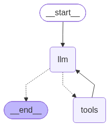

# Mortgage Underwriting Agent

An LLM agent that reviews mortgage applications against the Fannie Mae Selling Guide, the way a human underwriter would. It reads the borrower's file, looks up the rules it needs, does the math with real calculators, and ends with a decision (approve, approve with conditions, or decline) along with the rule IDs behind it.

The project has three main parts:

1. **RAG over the rulebook.** The Selling Guide is a 1,196-page PDF. I turned Part B3 (the borrower eligibility and underwriting rules) into a searchable index.
2. **An agent with tools.** A LangGraph agent that can search the guide and call calculators for LTV, DTI, cash to close, reserves, and date math.
3. **An evaluation set.** 120 synthetic applicants, each with an answer key produced by a separate rule checker written in plain Python, so the agent's decisions can be graded automatically.

On that set, the final version reaches **93% decision accuracy** and cites the correct rule **99%** of the time, up from 75% and 93% for the first version. See [Evaluation](#7-evaluation) for the full results.



---

## Why this project

Underwriting is a good fit for an agent because the work is a mix of things LLMs are good at and things they're bad at:

- **Good at:** reading a messy file, figuring out which rules apply, explaining a decision.
- **Bad at:** arithmetic, date math, and remembering exact limits.

So the main idea in this repo is simple: **the LLM decides what to check, and Python does the math.** The agent never computes a DTI in its head or guesses a waiting period. It looks the rule up and calls a tool.

---

## How it works

Here's what happens when the agent gets an application:

1. It receives the applicant's file as JSON. The answer key is removed first, so the agent never sees it.
2. It searches the Selling Guide for the topics in the file (credit events, DTI, large deposits, gifts, reserves).
3. It calls calculators for every number and date.
4. It writes up its reasoning and ends with two fixed lines that a script can read:

```
DECISION: approve with conditions
RULES: B3-4.2-02
```

Here's a real example. Sarah (`data/applicants/A007.json`) has $95,000 in the bank, but $40,000 of it is a recent deposit with no documented source. The agent found the large-deposit rule (B3-4.2-02), checked her reserves both with and without that deposit, and concluded she can close only if she documents where the money came from. That's **approve with conditions**, which matches the answer key.

---

## Project stages

The notebooks follow the order I built things in. Notebooks are where I explored ideas; once something worked, it moved into `src/mortgage_agent/`.

### 1. Turning the PDF into rules (`01_explore_guide.ipynb`)

- Used PyMuPDF and the PDF's table of contents to find where Part B3 starts and ends.
- Cleaned each page (repeated headers, ligatures, page numbers).
- Split the text into **123 rules**, each with its ID (like `B3-6-02`), title, last-updated date, and page range.
- Saved the result to `data/processed/b3_rules.json`.

### 2. Retrieval (`02_build_documents.ipynb`, `retrieval.py`)

- Split the 123 rules into **401 chunks** (1,500 characters, 200 overlap). Each chunk starts with a short header containing its rule ID and title, so a chunk from the middle of a rule still knows where it came from.
- Embedded them with `BAAI/bge-small-en-v1.5` and stored them in a local Qdrant database.
- Retrieval works in two stages:
  1. **Hybrid search:** semantic search plus BM25 keyword search, which pulls 20 candidates.
  2. **Reranking:** a cross-encoder (`BAAI/bge-reranker-base`) reads each candidate next to the question and keeps the best ones.

I tested this on two small question sets with known correct rules. "Everyday" questions are worded the way a borrower would ask them ("Can my parents help with the down payment?"). "Exact terms" questions use the guide's own vocabulary.

| Test set | Method | Hit@1 | Hit@3 | Hit@5 |
|---|---|---|---|---|
| Everyday (20) | Semantic | 85% | 95% | 100% |
| Everyday (20) | Hybrid | 90% | 95% | 95% |
| Everyday (20) | Hybrid + Rerank | 85% | 100% | 100% |
| Exact terms (10) | Semantic | 70% | 80% | 90% |
| Exact terms (10) | Hybrid | 80% | 100% | 100% |
| Exact terms (10) | Hybrid + Rerank | **100%** | **100%** | **100%** |

Hybrid + Rerank is what the agent uses. Keyword search helps a lot with exact terms, and the reranker fixes most of the ordering.

I also tried a few query tricks before this. None of them clearly beat the plain question:

| Method | Hit@1 | Hit@3 | Hit@5 |
|---|---|---|---|
| Baseline (original question) | 85% | 95% | 100% |
| + BGE query instruction | 85% | 95% | 100% |
| LLM query rewriting | 85% | 90% | 95% |
| Rank fusion (original + rewrite) | 80% | 95% | 100% |

Query rewriting fixed some questions ("parents" became "gift funds") but broke others by adding jargon the guide doesn't use. So I kept the simple version and let the agent rephrase its own searches when it needs to.

These test sets are small (one question is 5–10%), so treat the numbers as a sanity check, not a benchmark.

### 3. Applicant data (`03_applicants.ipynb`, `schemas.py`)

Each applicant is a Pydantic model with:

- the loan and property (amount, value, monthly payment, occupancy, property type)
- income (stated vs. verified)
- debts
- credit (score, bankruptcy, foreclosure)
- assets (bank and retirement balances, large deposits, gifts)
- `expected`, the answer key, which is never shown to the agent

Using Pydantic means a broken applicant file fails right away instead of quietly confusing the agent later.

### 4. Calculators and the rule checker (`04_scenario_factory.ipynb`, `calculators.py`, `rules.py`)

`calculators.py` handles the money: LTV, DTI (which debts count), cash to close, which deposits are unsourced, which gifts are allowed, usable assets, and months of reserves.

`rules.py` is the answer key. Each check returns a finding (a decline or a condition) with a rule ID, and `decide()` turns the findings into a final decision. It covers:

| Check | Rule |
|---|---|
| Minimum credit score (manual loans only; DU has none) | B3-5.1-01 |
| Debt-to-income ratio (50% max for DU) | B3-6-02 |
| Bankruptcy waiting period (Ch. 7: 4 years, Ch. 13: 2 years from discharge) | B3-5.3-07 |
| Foreclosure waiting period (7 years) | B3-5.3-07 |
| Large deposits that are needed to close | B3-4.2-02 |
| Enough funds for closing and reserves | B3-4.1-01 |
| Gift donors, gift letters, and gifts on investment properties | B3-4.3-04 |
| 5% minimum borrower contribution | B3-4.3-04 |

I checked these rules by hand against the actual B3 text, and that caught two mistakes in my first version. I had applied a minimum credit score to DU loans (there isn't one), and I had ignored short-term debts that can still count toward DTI.

### 5. Synthetic applicants (`05_generator.ipynb`, `generator.py`)

The generator builds a clean, approvable applicant and then adds one specific problem (a "trap"). There are 15 scenarios:

| Approve | Approve with conditions | Decline |
|---|---|---|
| no trap | large deposit needed to close | DTI too high |
| bankruptcy past waiting period | gift missing its letter | recent bankruptcy |
| foreclosure past waiting period | | recent foreclosure |
| large deposit not needed | | not enough funds |
| acceptable gift | | gift from an unacceptable donor |
| 5% contribution met | | gift on an investment property |
| | | 5% contribution not met |

That's 8 applicants per scenario, so **120 total** (48 approve, 16 approve with conditions, 56 decline), generated with a fixed seed so the set is reproducible. After building each applicant, the generator runs it through `rules.py` and raises an error if the answer isn't what the scenario was meant to produce. That way a bug in the generator can't quietly create a wrong answer key.

Files are in `data/applicants/generated/` (`G001.json` to `G120.json`), and `manifest.json` lists each applicant's scenario and expected answer.

### 6. The agent (`06_agent.ipynb`, `tools.py`)

The agent has six tools:

| Tool | What it does |
|---|---|
| `search_guide` | Searches the Selling Guide (the hybrid + rerank retrieval above) |
| `ltv` | Loan-to-value ratio |
| `dti` | Debt-to-income ratio |
| `funds_to_close` | Down payment plus closing costs |
| `reserves_months` | How many months of payments are left over after closing |
| `add_years` | Date math for waiting periods (handles leap days) |

The notebook builds the agent twice. First as a hand-written loop (ask the LLM, run the tools it asks for, repeat), so the mechanics are easy to see. Then as a LangGraph graph with an `llm` node and a `tools` node, which is the ReAct pattern (reason, act, repeat).

A system prompt gives the agent its job: review the whole file, look rules up instead of relying on memory, use tools for every number, cite rule IDs, and finish with the `DECISION` and `RULES` lines.

**About the model.** I started with `gpt-oss-120b` on Groq's free tier. It worked, but one applicant takes over a dozen LLM calls, and every call resends the whole conversation, search results included. That adds up to tens of thousands of tokens per applicant, so the free daily token limit ran out after just a handful of applicants. I moved to NVIDIA's free API catalog, first with `nvidia/nemotron-3-super-120b-a12b`. NVIDIA retired that model in the middle of the project, so the final runs use `nvidia/nemotron-3-ultra-550b-a55b`. Since the agent is built with LangChain, each switch was a one-line change.

### 7. Evaluation

The evaluation runs the agent on all 120 applicants and saves one result file per applicant (in `results/`), so a crash or a rate-limit error never loses finished work. The runs are resumable: re-running the loop only picks up applicants that don't have a successful result yet.

Each result is graded on three levels:

- **Outcome:** is the decision right, overall and per scenario?
- **Rule citation:** did it cite the rule that caused the problem, and only rules it actually read in a search result?
- **Process:** did it calculate with tools instead of in its head? (`add_years` on bankruptcy and foreclosure cases, `dti` and `funds_to_close` on every file, `reserves_months` whenever reserves are required)

#### Results

| | v1 (Super) | v2 (Ultra) | v3 (Ultra) | **v4 (Ultra)** |
|---|---|---|---|---|
| **Decision accuracy** | 75% | 83% | 91% | **93%** |
| Cited the expected rule | 93% | 100% | 94% | **99%** |
| Cited a rule it never read | 3 | 0 | 0 | **0** |
| `add_years` on date cases | 22% | 100% | 100% | **100%** |
| `dti` / `funds_to_close` used | 75% / 76% | 100% / 100% | 100% / 100% | **100% / 100%** |
| `reserves_months` when required | 69% | 97% | 97% | **98%** |
| Avg LLM calls per applicant | 9.3 | 6.4 | 6.3 | **6.2** |
| Avg input tokens per applicant | 59K | 27K | 27K | **24K** |

Full tables are in `results/comparison.csv` and `results/comparison_by_scenario.csv`.


## Assumptions

To keep the scope realistic, this project only covers part of real underwriting:

- All loans are run through **DU** (Fannie Mae's automated underwriting system). They're fixed-rate, purchase-only, and have a single borrower.
- The purchase price equals the appraised value.
- There are no extenuating circumstances, so the shorter waiting periods never apply.
- Bankruptcy and foreclosure are treated as separate events.
- Retirement balances count in full.
- Gifts are listed separately from the bank balance, and donors don't live with the borrower.
- Maximum LTV isn't checked, because it lives in the Eligibility Matrix (a separate document that isn't indexed). Generated LTVs are 70–80%, or 90% in the minimum-contribution scenarios.
- Debts with 10 or fewer payments left aren't generated, so the "significant impact" judgment call never comes up.

---

## Repo layout

```
mortgage-underwriting-agent/
├── data/
│   ├── raw/                  # Selling Guide PDF (not included, see below)
│   ├── processed/            # b3_rules.json: 123 rules from Part B3
│   ├── applicants/           # A007 (Sarah) + generated/G001–G120
│   └── qdrant/               # local vector database (built by notebook 02, not tracked)
├── docs/
│   └── agent_graph.png
├── notebooks/
│   ├── 01_explore_guide.ipynb
│   ├── 02_build_documents.ipynb
│   ├── 03_applicants.ipynb
│   ├── 04_scenario_factory.ipynb
│   ├── 05_generator.ipynb
│   └── 06_agent.ipynb
├── results/                  # one JSON per applicant per run, plus comparison tables
└── src/mortgage_agent/
    ├── schemas.py            # Pydantic applicant models
    ├── calculators.py        # the money math
    ├── rules.py              # rule checker = answer key
    ├── generator.py          # synthetic applicants
    ├── retrieval.py          # hybrid search + reranking
    └── tools.py              # tools the agent can call
```

---

## Running it

1. **Get the PDF.** The Selling Guide isn't included in this repo. Download it from [selling-guide.fanniemae.com](https://selling-guide.fanniemae.com) (I used the September 2, 2026 version) and save it as `data/raw/selling_guide.pdf`.

2. **Install the dependencies.**

   ```bash
   python -m venv .venv
   source .venv/bin/activate
   pip install pymupdf pydantic python-dotenv jupyter \
       langchain langchain-core langchain-text-splitters langchain-huggingface \
       langchain-qdrant qdrant-client fastembed sentence-transformers \
       langgraph langchain-nvidia-ai-endpoints pandas
   ```

3. **Add an API key.** Create a free key at [build.nvidia.com](https://build.nvidia.com) and put it in a `.env` file in the project root:

   ```
   NVIDIA_API_KEY=nvapi-...
   ```

4. **Build the index.** Run `notebooks/02_build_documents.ipynb` once. It creates the Qdrant database in `data/qdrant/`. (`b3_rules.json` is already included, so notebook 01 is only needed if you want to re-extract the rules.)

5. **Run the agent.** Open `notebooks/06_agent.ipynb` and run the cells through section 5. That section underwrites Sarah's application step by step.

6. **See the results.** The Results cell in section 7 scores the saved runs in `results/` without making any LLM calls. Only run the section 6 loop if you want a fresh run: it makes about 750 LLM calls, so on a free tier it can take a while and may need to pause for rate limits.

---

## Next steps

Things I'd do with more time:

- **Parse tables properly.** The waiting-period mistake came from a PDF table that lost its columns. Keeping column labels in each chunk (for example `Foreclosure | standard: 7 years | with extenuating circumstances: 3 years`) would fix it at the source instead of in the prompt.
- **Work on the large-deposit rule**, the agent's main remaining weakness.
- **Model gift-transfer documentation** in the dataset, so the answer key matches the full Selling Guide rule.
- **Run each version several times** to measure how much results vary from run to run.
- **Move the agent and evaluation code** from the notebook into `src/`.

---

## Data source

Fannie Mae Selling Guide, published September 2, 2026. The rules belong to Fannie Mae and are used here for a learning project. All applicants in this repo are synthetic.
